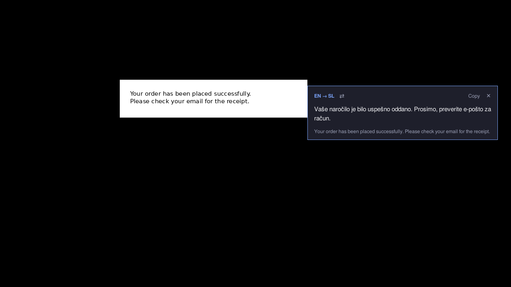

# Screen Translator (SL ⇄ EN)

A small desktop tool for translating text anywhere on your screen. Press a hotkey,
drag a box around some text, and the translation pops up right next to it.
It translates **Slovenian → English** and **English → Slovenian**, and it detects the
direction automatically.

It works on anything you can see: websites, PDFs, images, videos, apps, even text in
screenshots that you can't select or copy.



## How it works

```
 Ctrl+Alt+T ──► freeze screen ──► drag a box ──► OCR ──► detect language ──► translate ──► popup
   (pynput)        (mss)           (tkinter)   (Tesseract)  (offline check)     (DeepL)     (tkinter)
```

1. **Hotkey:** the script runs in the background and listens for `Ctrl+Alt+T`.
2. **Freeze and select:** it takes a screenshot of all monitors and shows it, dimmed,
   as a fullscreen overlay. You drag a box, and the selected area is shown un-dimmed.
   Freezing the screen means you get exactly what you selected, even from a video.
3. **Read the text (OCR):** the selected area is cropped, upscaled, converted to
   grayscale, and inverted if it's dark mode. Then Tesseract reads it with the
   Slovenian and English models. Line breaks are joined back into full sentences.
4. **Detect the language:** a small offline check looks for č/š/ž and common
   Slovenian or English words, so it costs no extra API call. Slovenian text is
   translated to English, and English text to Slovenian.
5. **Translate:** DeepL is used if a key is configured. Otherwise it uses Google
   Translate's free endpoint. This runs in a background thread, so the UI never
   freezes.
6. **Popup:** the translation appears next to the box, or on the other side if
   there's no room on screen, along with the original text underneath.

## Usage

| Action | Keys |
|---|---|
| Translate something | **Ctrl + Alt + T**, then drag a box around the text |
| Cancel the selection | Esc or right-click |
| Wrong direction? Flip it | **⇄** in the popup |
| Copy the translation | **Copy** in the popup |
| Move / close a popup | drag the header / ✕ or Esc |
| Quit | Ctrl + Alt + Q |

## Setup (Windows)

1. **Install Python 3.10+.**
2. **Install Tesseract OCR** from the
   [UB Mannheim installer](https://github.com/UB-Mannheim/tesseract/wiki). Under
   *Additional language data*, tick **Slovenian**. English is included by default.
3. **Install the dependencies:**
   ```
   python -m venv .venv
   .venv\Scripts\activate
   pip install -r requirements.txt
   pip install deepl
   ```
4. **Add your DeepL key** (optional, but recommended): get a free one at
   [deepl.com/pro-api](https://www.deepl.com/pro-api), then create a file called
   `deepl_key.txt` next to the script containing only the key. This file is in
   `.gitignore`, so it's never committed.
5. **Run it:**
   ```
   python screen_translator.py
   ```
   The startup line shows which translator is active. Use `pythonw` instead of
   `python` to run it without a console window.

## Configuration

These settings are at the top of `screen_translator.py`:

- `HOTKEY` / `QUIT_HOTKEY`: the hotkeys, e.g. `"<ctrl>+<shift>+<f9>"`
- `LANG_A` / `LANG_B`: the language pair (default `sl` / `en`)
- `TESSERACT_LANG`: the OCR models (default `slv+eng`)
- `POPUP_WIDTH`: how wide the popup is

## Tech stack

Python · tkinter · [Tesseract OCR](https://github.com/tesseract-ocr/tesseract) ·
[mss](https://github.com/BoboTiG/python-mss) · [pynput](https://github.com/moses-palmer/pynput) ·
[DeepL API](https://www.deepl.com/pro-api) · Pillow

## Troubleshooting

- **"Tesseract is not installed":** set the `TESSERACT_CMD` environment variable to
  the full path of `tesseract.exe`.
- **"missing language data: slv":** put `slv.traineddata` (from
  [tessdata_best](https://github.com/tesseract-ocr/tessdata_best)) into
  `C:\Program Files\Tesseract-OCR\tessdata\`.
- **Translator shows "Google (free)" instead of DeepL:** check that `deepl_key.txt`
  is in the same folder as the script, and that it isn't named `deepl_key.txt.txt`.
- **Bad OCR results:** select just the text with a little margin around it. For
  tiny fonts, zoom in first (Ctrl +).
